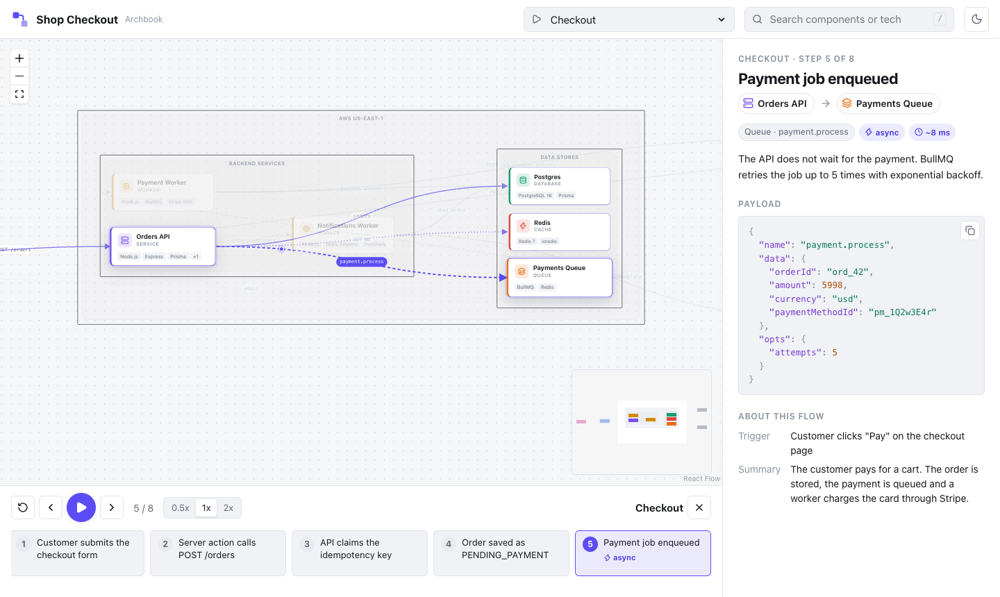

# Archbook

**Living, replayable architecture docs, generated by Claude Code.**

Archbook is the Storybook of architecture. It gives your project:

- **A navigable diagram** of apps, services, databases, queues and third-party systems.
- **An explanation of every component**, linked to the code that implements it.
- **Flow replay**: pick a flow such as "Checkout" and watch the request travel through the system step by step, with the payload of each hop.

<!-- Placeholder: replace with docs/assets/replay.gif, recorded from `pnpm dev:example`. -->



## Why

- **Diagrams rot. This one is checked against the code.** The docs are one JSON file in your repo. `archbook validate` fails when a cited file or line range no longer exists, and `/archbook-sync` updates only what changed.
- **Explaining a flow takes a whiteboard and half an hour. Replaying it takes a link** like `#/flow/checkout/step/3`.
- **Any stack.** Go, Python, Java or Node: the viewer ships prebuilt inside the CLI, so you don't need React or a frontend build.
- **Reviewable and reversible.** Plain JSON that diffs well in pull requests, a snapshot before every AI change, and `archbook undo`.

## Quick start

You need Node.js 20.12+ and [Claude Code](https://docs.claude.com/en/docs/claude-code) (for generation).

```sh
npx archbook init       # a few questions; installs the Claude Code commands in .claude/
npx archbook generate   # Claude Code maps the code and writes archbook/architecture.json
npx archbook dev        # opens the viewer at http://localhost:4400
```

Prefer to stay inside Claude Code? After `init`, run `/archbook-generate` there.

Want to see it first? Clone this repo, then run `pnpm install && pnpm build && pnpm dev:example`.

## Commands

| Command                                             | What it does                                                                                                                                     |
| --------------------------------------------------- | ------------------------------------------------------------------------------------------------------------------------------------------------ |
| `archbook init`                                     | Detects the stack, asks about audience, language, detail level and key flows, writes `archbook/config.json` and installs the Claude Code assets. |
| `archbook generate`                                 | Runs Claude Code headless to write `archbook/architecture.json`. Restores the previous file if it fails or you press Ctrl+C.                     |
| `archbook dev`                                      | Serves the viewer with live reload (port 4400).                                                                                                  |
| `archbook build [--out dir]`                        | Builds a static site (default `archbook/dist`) for GitHub Pages or any static host.                                                              |
| `archbook validate [--json]`                        | Checks the schema, references between elements, and that every cited file and line range exists.                                                 |
| `archbook history`                                  | Lists snapshots and what each operation changed (`+2 nodes, -1 flow, 3 nodes changed`).                                                          |
| `archbook undo [--to <id>]`                         | Restores the previous version. Run it again to redo.                                                                                             |
| `archbook remove [--keep-docs] [--dry-run] [--yes]` | Removes everything Archbook installed, using its manifest, after a backup.                                                                       |

Inside Claude Code:

| Command                            | What it does                                                                            |
| ---------------------------------- | --------------------------------------------------------------------------------------- |
| `/archbook-generate`               | Full generation: scanner, then one flow tracer per flow, then writer, then validator.   |
| `/archbook-add-flow <description>` | Traces one more flow and adds it without touching the rest.                             |
| `/archbook-sync`                   | Finds what changed in the code since the last generation and proposes targeted updates. |
| `/archbook-explain <node-id>`      | Reads a component's code and writes a deeper description.                               |

### As a Claude Code plugin

The same commands, agents and skills install as a plugin straight from this repository:

```sh
claude plugin marketplace add filipe-campos/archbook
claude plugin install archbook@archbook
```

Plugin commands are namespaced: `/archbook:generate`, `/archbook:add-flow`, `/archbook:sync`, `/archbook:explain`.

## How it works

```text
your code ──▶ Claude Code (commands, agents, skills) ──▶ archbook/architecture.json ──▶ viewer
```

- **The schema is the contract.** [`docs/schema.md`](docs/schema.md) documents every field. Add `"$schema": "https://unpkg.com/archbook@0.1/schema/architecture.schema.json"` for autocomplete in your editor.
- **The viewer and the AI are separate.** The viewer only reads the JSON file and always renders it the same way. The AI only writes that file.
- **Nothing is invented silently.** Every node and edge points to the code that proves it, and validation fails when a path does not exist.
- **Edit by hand whenever you like.** The AI updates only what changed and keeps ids stable.
- **Safe to try, safe to remove.** Every AI change is preceded by a snapshot in `archbook/.history/`. `archbook remove` deletes exactly what `init` installed, restores any file it changed, and keeps a backup in your temp folder.

### Publish to GitHub Pages

```yaml
# .github/workflows/architecture.yml
on: { push: { branches: [main] } }
permissions: { pages: write, id-token: write }
jobs:
  deploy:
    runs-on: ubuntu-latest
    environment: github-pages
    steps:
      - uses: actions/checkout@v7
      - run: npx archbook build
      - uses: actions/upload-pages-artifact@v5
        with: { path: archbook/dist }
      - uses: actions/deploy-pages@v5
```

## Roadmap

- GitHub Action that detects drift between code and docs and comments on pull requests.
- Open source files straight in VS Code (`vscode://` links).
- Presentation mode: guided slides built from flows.
- Several architecture files (split by domain) and C4-style zoom levels.
- Visual editing in the viewer, saved back to the JSON.
- Support for AI agents other than Claude Code.

## Contributing

Contributions are welcome, especially **detection recipes**: short guides that teach the agents to recognize a framework, queue or data store. See [CONTRIBUTING.md](CONTRIBUTING.md).

## License

[MIT](LICENSE)
